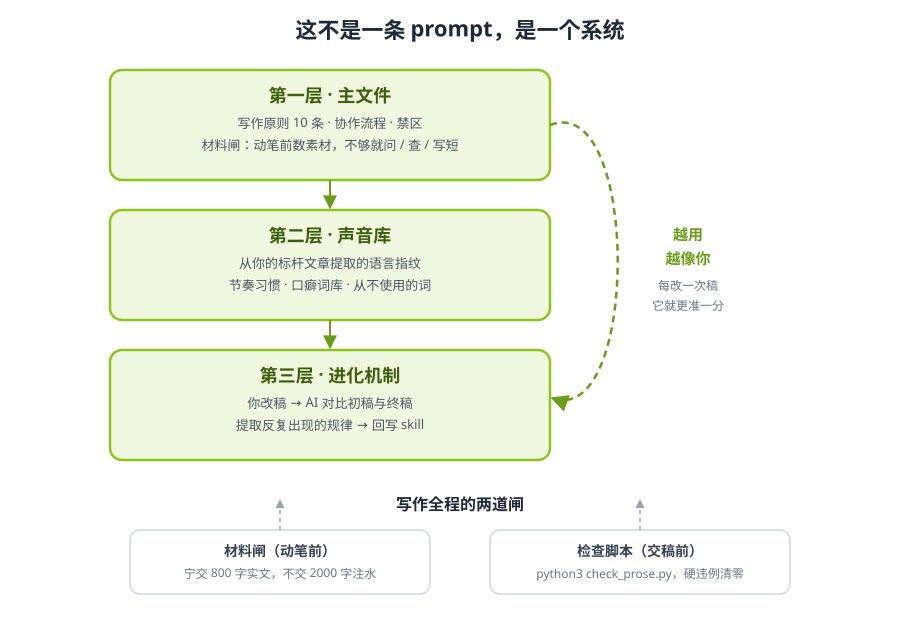

<div align="center">

# 与你同学写作法.skill

> *「AI 味的解药能写进代码，没人味的解药只在你活过的日子里。」*

[](LICENSE)
[](https://agentskills.io)
[](https://python.org)

**让 AI 用你的口味写中文长文——通用闸门打底，你的声音库定调，进化机制让它越用越像你。**

[安装](#安装) · [使用](#使用) · [工作原理](#工作原理) · [长出你自己的声音](#三步长出你自己的声音) · [FAQ](#faq) · [仓库结构](#仓库结构)

</div>

---

AI 写中文长文有两个病。

一个叫 **AI 味**：翻案腔、套话、「不是……而是……」、均匀的排比——这些可以写进负面清单，一个脚本扫干净。

另一个更重，叫 **没人味**：文章读起来流畅，但你读完说不出是谁写的。没有日期，没有正在发生的事，没有一个文章之外的人。这个病任何 prompt 都治不了——因为它缺的不是修辞，是**料**。

这个 skill 对两个病各有一套办法：负面清单交给硬规则和检查脚本，正面缺失交给协作流程和进化机制。它是[与你同学 Learn With You](#关于作者)在公众号长文写作中实际使用的系统，现在开源。

## 安装

基于开放的 [Agent Skills](https://agentskills.io) 协议，可在任何 skills-compatible 的 AI agent runtime 中运行。

### 方式一：一行命令（推荐，跨 runtime）

打开你正在用的 agent（Claude Code、Codex、Cursor 等），告诉它：

```
帮我安装这个 skill：https://github.com/learnwithu/learn-with-u-writer
```

或者用通用 CLI 安装器（[vercel-labs/skills](https://vercel-labs/skills)）：

```bash
npx skills add learnwithu/learn-with-u-writer
```

### 方式二：手动安装

| Runtime | 安装路径 |
|---------|---------|
| Claude Code | `~/.claude/skills/learn-with-u-writer/` |
| Codex CLI | `~/.codex/skills/learn-with-u-writer/` |
| Cursor | `~/.cursor/skills/learn-with-u-writer/` |

```bash
git clone https://github.com/learnwithu/learn-with-u-writer ~/.claude/skills/learn-with-u-writer/
```

### 方式三：作为 Prompt 使用

没有 coding agent 也可以。把 `SKILL.md` 的内容整份粘贴进对话，跟在你的写作需求后面——它本质就是一份 markdown。

## 使用

装好后，直接用自然语言告诉 agent：

```
用 learn-with-u-writer 帮我写一篇公众号文章，选题是 XXX，
我的观点是 XXX，我有这些真实素材：……
```

它会按流程走：**先磨论点（三个问题），再数材料（不够会向你要），然后出初稿，交稿前自动过检查脚本。** 你改定稿后说一句「提取规律」，它就把你的改动模式存回 skill——下次写，更像你。

## 工作原理

<div align="center">

</div>

**第一层，主文件。** 10 条写作原则 + 协作流程 + 禁区清单。规矩包括：开头必须是"我"的反应、全篇比喻 ≤2 个、结尾给判断不给总结、文章里必须有文章之外的世界（时间戳、正在发生的事、具体的人）。

**第二层，声音库。** 从你的标杆文章提取的语言指纹：节奏习惯、口癖词库、从不使用的词。内置的一份是原作者的示例配置，展示的是「声音档案长什么样」。

**第三层，进化机制。** 最关键的一层：你改稿，AI 对比初稿和终稿，提取反复出现的改动规律，回写进 skill。你的每一次修改都在训练它。

全程有两道闸把关：**材料闸**（动笔前）——数素材，1200 字以上的稿子至少要 5 件具体材料，凑不够就问、就查、就写短，宁交 800 字实文不交 2000 字注水；**检查脚本**（交稿前）——`check_prose.py` 自动扫描禁用词、翻案腔变形族，统计句长变异系数和连词密度，硬违例清零才放行。

## 你能用它写什么

| 你在写什么 | skill 给你的支持 | 需要你提供 |
|------------|----------------|-----------|
| 公众号长文 | 完整流程 + SEO/GEO 交付规格 | 选题、观点、真实素材 |
| 知乎回答 / 博客 | 同一套闸门与节奏规则 | 选题、观点、真实素材 |
| 深度行业解读 | 论点三问 + 材料闸防注水 | 你的行业判断 |
| 产品/工具分享文 | 谦逊铺垫 + 逐一展示升番 | 你的真实使用体验 |
| 方法论文章 | 教判断不教工具的结构 | 你验证过的做法 |

**不支持**：英文写作（规则基于中文写作语料）、小红书/朋友圈等短内容、商务文案。

## 为什么不是又一个「去 AI 味」prompt

市面上大多数方案在做同一件事：往 prompt 里塞「写得口语一点」「别用 AI 腔」。

这治不了本，因为模型会换一套字面继续做同一个动作。本 skill 在三个层面上不同：

1. **禁动作，不禁字面。** 翻案腔禁的是「先给读者立一个他没有的误解，再推翻它」这个动作本身，七类变形外衣一张表全拦。
2. **规则带配额。** 每条正面规则都有反滥用条款——比喻必须配额（≤2 个），口癖禁均匀分布，金句必须有叙事垫底。规则被字面执行会产生「合规的 AI 味」，配额是对冲。
3. **承认为什么治不了全部。** 脚本能查「什么不该有」，永远查不出「有没有生命力」。没人味的解药不在代码里——所以这个 skill 的诚实定位是：**保证下限，上限永远在作者手里的那袋料上。**

## 三步长出你自己的声音

内置的声音配置是原作者的，不是让你模仿他。这个 skill 真正的卖点在这里：

**第一步 · 跑三篇。** 用它写三篇你自己的文章，提供你自己的真实素材。

**第二步 · 改稿 + 提取规律。** 把 AI 初稿改成你满意的样子，然后对 AI 说「提取规律」。它会对比初稿和终稿，找出你反复出现的改动模式（只提取出现 ≥2 次的，单次不提取），按 `evolution/modification-rules.md` 的格式呈现给你确认。

**第三步 · 回写。** 确认后写入高/低置信度区。跑得越多，`references/voice-examples.md` 里的内容越像你——直到那份示例配置完全被你自己的声音覆盖。

原作者跑了半年的真实提取记录，作为示例放在 `evolution/modification-rules.md` 里。

## FAQ

<details>
<summary><strong>和「往 prompt 里写『口语一点』」有什么区别？</strong></summary>

prompt 是一句指令，说完就散。这是一套带材料闸、检查脚本和进化机制的完整流程：规则可执行、可累积，而且每次改稿都在让它更准。

</details>

<details>
<summary><strong>没有 coding agent，只有 ChatGPT 网页版，能用吗？</strong></summary>

能。把 <code>SKILL.md</code> 全文粘贴进对话，跟在你的写作需求后面即可。检查脚本用不了（需要本地 Python），其余流程全部可用。

</details>

<details>
<summary><strong>支持哪些模型？</strong></summary>

任何能读 skill 文件的 agent runtime。实测 GLM、DeepSeek 等国产模型即可跑通完整流程——这个 skill 的前提就是：模型管执行力，系统管判断力。

</details>

<details>
<summary><strong>用了会写出和你（原作者）一样的文章吗？</strong></summary>

不会。内置声音库只是示例配置。按「三步长出你自己的声音」跑完，它长出来的是你的声音，不是原作者的。

</details>

<details>
<summary><strong>材料闸说要 5 件材料，我凑不够怎么办？</strong></summary>

它会按顺序做三件事：向你提问（一次最多三个）→ 查公开资料 → 都不行就把文章写短。这不是缺陷，是设计：一篇没有料的 2000 字长文，不如一篇有料的 800 字短文。

</details>

## 仓库结构

```
learn-with-u-writer/
├── SKILL.md                          # skill 本体：原则、流程、禁区
├── README.md                         # 本文件
├── LICENSE                           # MIT
├── CHANGELOG.md                      # 版本记录
├── VERSION
├── scripts/
│   └── check_prose.py                # AI 味检查脚本（硬违例 + 统计警告）
├── references/
│   ├── voice-examples.md             # 声音模式库（示例配置，待你替换）
│   ├── prose-craft.md                # 文采机制手册（金句时机、借物承情等）
│   └── content-methodology.md        # 选题流水线（HKR 质检、文章五原型）
├── evolution/
│   └── modification-rules.md         # 修改规律示例（进化提取的真实产出格式）
└── assets/
    └── skill-structure.svg           # 结构图
```

## English

**Learn With You Writing Skill** — a collaborative Chinese long-form writing skill for AI agents. It combines a material gate (no padding without real substance), an action-level ban on AI-flavored rhetoric, a prose check script, and an evolution mechanism that learns from your edits to sound more like *you* with every article. Chinese writing only. Install by telling your agent: `帮我安装这个 skill：https://github.com/learnwithu/learn-with-u-writer`

## 关于作者

**Bob（李波/波哥）** — AI 企业落地顾问，「与你同学 Learn With You」主理人

| 平台 | 链接 |
|------|------|
| 🎵 抖音 | 搜「与你同学 learn with you」（抖音号：learnwithyou） |
| 📕 小红书 | 搜「与你同学 learn with you」（小红书号：learnwithyou） |
| ✖️ X (Twitter) | [@learnwithyou_](https://x.com/learnwithyou_) |
| 📱 视频号 | 搜「与你同学 learnwithyou」 |
| 💬 公众号 | 微信搜「与你同学 learnwithyou」 |

## 许可证

MIT — 随便用，随便改。详见 [LICENSE](LICENSE)。

> 本项目按兴趣维护，不承诺更新频率。

---

*「模型管执行力，系统管判断力。」*
